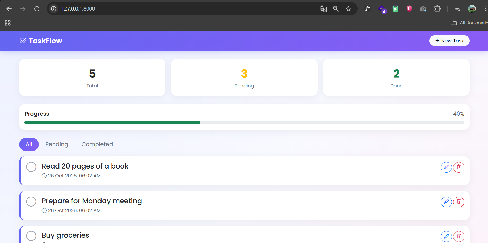
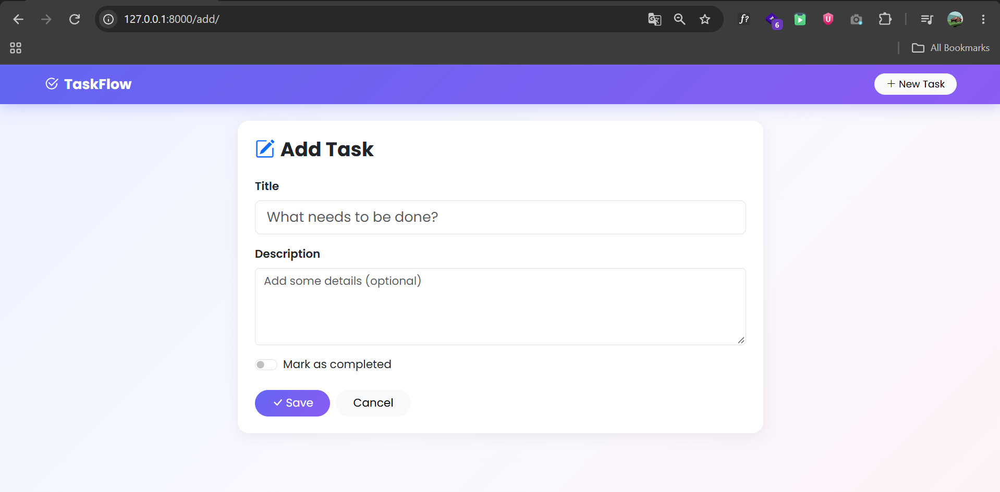
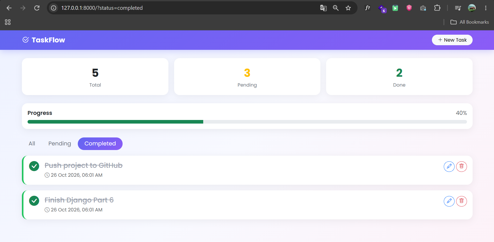

# TaskFlow - Django ToDo App

A clean, responsive ToDo application built with **Django** and **Bootstrap 5**. Users can create, edit, complete and delete tasks, filter them by status, and track their progress.

## Features

- Add, edit and delete tasks
- Mark tasks as completed or pending with one click
- Filter tasks: All / Pending / Completed
- Dashboard with task statistics and a progress bar
- Success and warning messages after each action
- Django admin panel for managing data
- Responsive design that works on mobile and desktop

## Screenshots

### Home


### Add Task


### Completed Tasks


## Tech Stack

- Python 3
- Django 6
- SQLite
- Bootstrap 5 and Bootstrap Icons
- HTML and CSS

## Getting Started

1. Clone the repository
   ```bash
   git clone https://github.com/shreyash3128/django-todo-app.git
   cd django-todo-app
   ```

2. Create and activate a virtual environment
   ```bash
   python -m venv venv
   venv\Scripts\activate
   ```
   On Mac/Linux use `source venv/bin/activate`.

3. Install dependencies
   ```bash
   pip install -r requirements.txt
   ```

4. Set up the database
   ```bash
   python manage.py migrate
   ```

5. (Optional) Create an admin user
   ```bash
   python manage.py createsuperuser
   ```

6. Run the server
   ```bash
   python manage.py runserver
   ```

7. Open http://127.0.0.1:8000/ in your browser.

## Project Structure

```
todo_project/
├── manage.py
├── todo_project/    # project settings and main URLs
└── tasks/           # app: models, views, forms, templates, static files
```

## What I Learned

- Django MVT architecture
- URL routing, views and templates
- ModelForm and form validation
- CSRF protection and the POST/Redirect/GET pattern
- Template inheritance and the messages framework
- Serving static files and styling with Bootstrap

## Roadmap

- [ ] User registration and login
- [ ] Separate tasks for each user
- [ ] Due dates and priorities
- [ ] Deploy online

## Author

Your Name - [GitHub](https://github.com/shreyash3128)